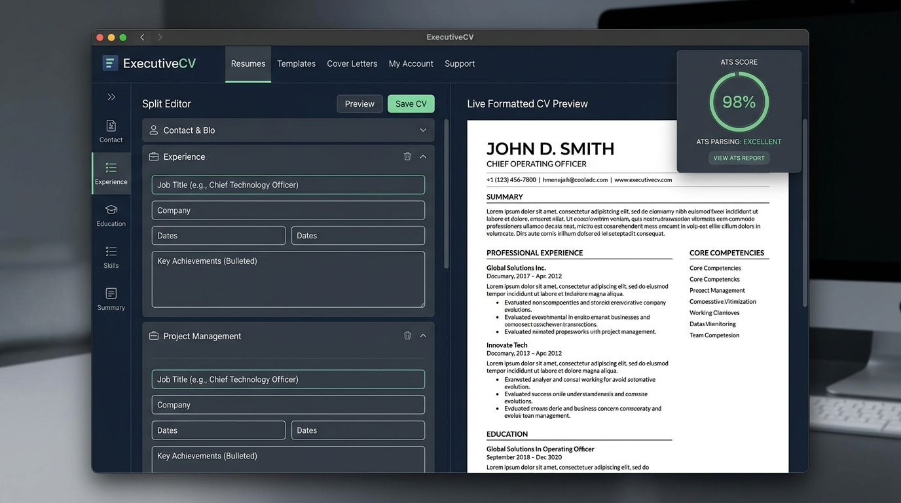
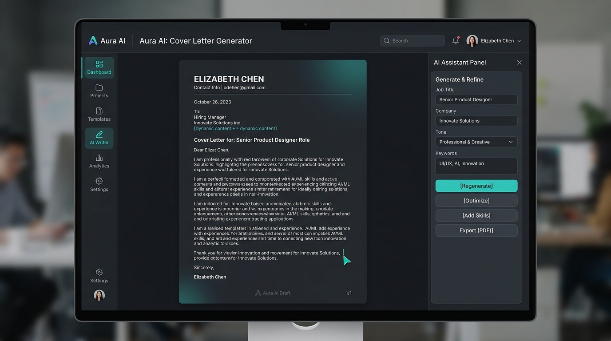
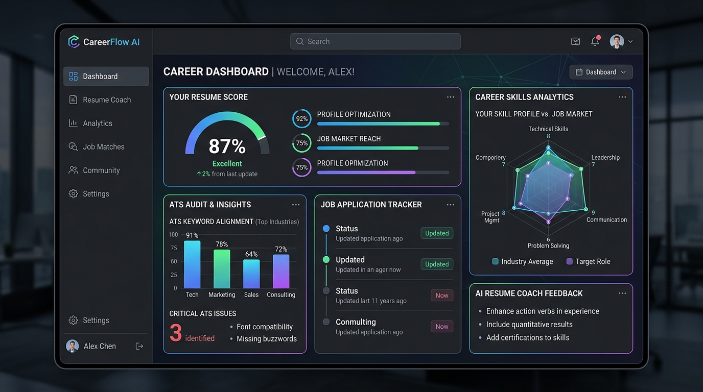
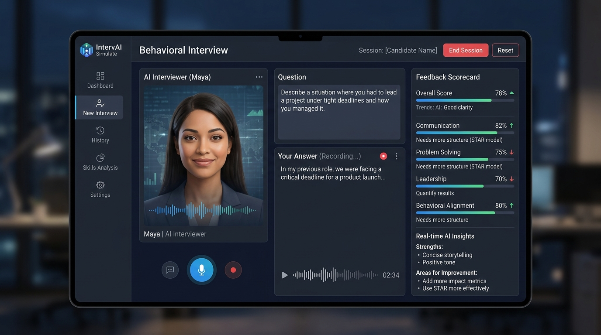
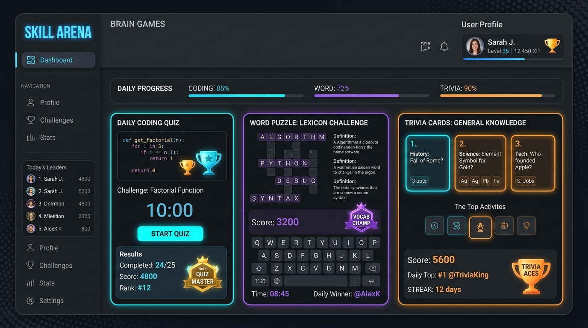
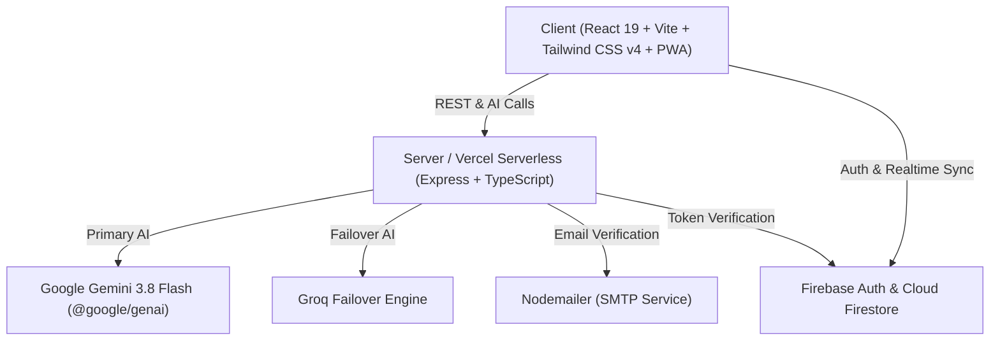

# RahmoraAI — Intelligent Career, Resume & Cover Letter Platform

[](https://billuhassan.github.io/CV-certificate-ai/)
[](LICENSE)
[](https://react.dev/)
[](https://www.typescriptlang.org/)
[](https://ai.google.dev/)
[](https://firebase.google.com/)
[](https://tailwindcss.com/)

> **RahmoraAI** (formerly CVCraft AI) is an intelligent, full-stack career platform designed to help candidates build ATS-optimized resumes, generate tailored cover letters, run AI mock interviews, audit candidate profiles, and sharpen technical problem-solving skills with gamified challenges.

---

## 🖥️ Live GitHub Demo & Website Walkthrough

Experience the full interactive demo directly hosted on GitHub without needing an external cloud server:

🔗 **[Launch Interactive GitHub Demo](https://billuhassan.github.io/CV-certificate-ai/)**  
*(Or open [`docs/index.html`](docs/index.html) locally in any web browser).*

---

### 📸 Complete Platform Visual Showcase

#### 1. Executive ATS Resume & Certificate Studio
> Recruiter-tested layouts with customizable typography, dynamic themes, PDF/Word export, and deterministic ATS parsing without AI hallucinations.
<p align="center">
  
</p>

#### 2. AI Grounded Cover Letter Generator
> Auto-generate personalized, highly persuasive cover letters referencing specific target company details, role competencies, and verified achievements.
<p align="center">
  
</p>

#### 3. AI Resume Coach & 3D Audit Analytics
> Multi-dimensional audit analyzing ATS keyword density, formatting hygiene, impact metrics, and recruiter callback probability with concrete suggestions.
<p align="center">
  
</p>

#### 4. Interview AI Intelligence Simulator
> Rehearse behavioral and technical interviews with AI persona interviewers, speech input, real-time STAR scoring, and personalized answer enhancement tips.
<p align="center">
  
</p>

#### 5. Daily Skill Arena & Cognitive Brain Games
> Sharpen problem-solving skills with gamified challenges: Daily Sudoku, Coding Quizzes, Word Matrix, Math Crunch, and Career Lexicon Wordle with daily streak tracking.
<p align="center">
  
</p>

---

## ✨ Key Features

### 📄 1. AI-Powered Resume Builder
- **10+ Canva-Inspired ATS Templates**: Curated layouts spanning Classic, Minimalist, Tech, Executive, Modern, and Creative styles.
- **Multimodal Resume Upload**: Upload existing PDF or DOCX resumes; our deterministic parser extracts personal info, experiences, education, and skills directly into editable fields.
- **Dynamic Themes & Typography**: Switch between curated color themes (*Fire Obsidian, Cyber Neon, Emerald Mint, Slate Dark, Crimson Flame*) and font pairings (*Plus Jakarta Sans, Space Grotesk, Outfit, Playfair Display, Syne, Inter*).
- **Snapshot Versioning**: Save, preview, restore, or fork multiple versions of your resume at any time.
- **Multi-Format Export**: One-click export to high-resolution PDF, editable Microsoft Word (`.docx`), or native print layout.

### 🎯 2. ATS Optimization & AI Resume Audit
- **Gemini 3.8 Flash AI Core**: Instant grammar polish, high-impact bullet rewriting, and professional profile summary generation.
- **ATS Keyword Matcher**: Compare your resume against any job description to discover missing keywords, match percentage, and targeted optimization tips.
- **Role & Domain Intelligence**: Smart industry skill suggestions tailored to engineering, finance, culinary arts, healthcare, design, and operations.

### ✉️ 3. Intelligent Cover Letter Generator
- **Context-Aware Drafting**: Generates personalized, persuasive cover letters based on your selected resume and target job role/company.
- **Custom Tone & Framing**: Adjust professional tone, key highlights, and structure in real time.

### 🎙️ 4. Interview Intelligence Suite
- **Custom Mock Interviews**: Generates realistic behavioral, technical, and situational interview questions for any job profile.
- **AI Answer Evaluation**: Receive detailed scoring, constructive feedback, STAR-method alignment, and suggested sample answers.

### 🎮 5. Daily SkillArena & Leaderboards
- **Gamified Cognitive Challenges**: Daily Sudoku, Word Matrix, Math Crunch, Daily Wordle, and Coding Quizzes.
- **Public Leaderboards & Streaks**: Real-time scoring, completion times, and daily streak tracking across the community.

### 💬 6. Real-Time Collaboration & Direct Messaging
- **Peer-to-Peer Direct Messaging**: Connect and message registered platform members in real time.
- **Admin Live Support Chat**: Live customer support channel with secure screenshot/media attachment uploads (<700 KB).
- **Ratings & Reviews**: Transparent community feedback system with verified user reviews.

---

## 🛡️ Security & Hardening Architecture

RahmoraAI includes robust, production-grade security controls:

- **Dual-Engine AI Failover**: Flagship **Google Gemini 3.8 Flash** with automatic round-robin failover to **Groq** (`qwen/qwen3.8-27b`, `openai/gpt-oss-120b`) to prevent quota disruptions.
- **Sliding-Window Rate Limiting**: In-memory IP rate limiting on authentication and AI endpoints to defend against credential stuffing, brute-force attacks, and quota abuse.
- **Cryptographic Password Recovery**: Single-use 256-bit cryptographically secure reset tokens with short TTLs (15 minutes) and 5-attempt brute-force lockouts.
- **Firestore Security Rules**: Strict relational gatekeeper checks preventing privilege escalation, unauthorized profile modifications, negative counters, and ghost field injections.
- **No Hardcoded Secrets**: All sensitive keys, tokens, and SMTP credentials run server-side via environment variables; secrets are never bundled into client distributions.
- **Defensive HTTP Headers**: Enforces `X-Content-Type-Options: nosniff`, `X-Frame-Options: SAMEORIGIN`, and removes server technology identifiers.

---

## 🏗️ Architecture & Tech Stack



| Layer | Technologies |
| :--- | :--- |
| **Frontend** | React 19, TypeScript, Vite 6, Tailwind CSS v4, Lucide React, Motion (Framer Motion) |
| **Backend** | Node.js, Express, ESBuild, TSX, Firebase Admin SDK, Nodemailer |
| **Database & Auth** | Firebase Authentication, Cloud Firestore (Offline Long-Polling) |
| **AI Providers** | Google Gemini 3.8 Flash, Groq API (`qwen3.8`, `gpt-oss`) |
| **Document Processing** | `pdf-parse`, `mammoth` (DOCX), `jspdf`, `html2canvas` |
| **Offline Support** | PWA Service Worker via `vite-plugin-pwa`, `localStorage` caching |

---

## 🚀 Quick Start

### Prerequisites
- [Node.js](https://nodejs.org/) (v18 or higher recommended)
- [npm](https://www.npmjs.com/) or [bun](https://bun.sh/)
- A free [Google Gemini API Key](https://aistudio.google.com/app/apikey)

### 1. Clone the Repository
```bash
git clone https://github.com/billuHassan/CV-certificate-ai.git
cd CV-certificate-ai
```

### 2. Install Dependencies
```bash
npm install
```

### 3. Configure Environment Variables
Copy the example environment template:
```bash
cp .env.example .env
```
Open `.env` and configure your API keys:
```env
# Required for full AI functionality
GEMINI_API_KEY=your_gemini_api_key_here

# Optional: Secondary failover provider
GROQ_API_KEY=your_groq_api_key_here

# Server & URL Settings
APP_URL="http://localhost:3000"
NODE_ENV="development"

# Optional: Real email verification delivery
SMTP_HOST=smtp.gmail.com
SMTP_PORT=587
SMTP_USER=your_email@gmail.com
SMTP_PASS=your_app_password
SMTP_FROM="RahmoraAI <noreply@yourdomain.com>"

# Optional: Admin Configuration
ADMIN_EMAIL=your_admin_email@example.com
ADMIN_API_KEY=your_secure_admin_api_key
```

### 4. Start Development Server
```bash
npm run dev
```
Open your browser at **`http://localhost:3000`**.

---

## 📦 Build & Deployment

### Production Build
To create an optimized production bundle:
```bash
npm run build
```
This builds:
1. Vite client bundle in `dist/`
2. Standalone server bundle in `dist/server.cjs`
3. Vercel serverless function entrypoint in `api/index.js`

### Running the Production Server
```bash
npm start
```

### Deploying to Vercel
1. Push your repository to GitHub.
2. Import the repository into your [Vercel Dashboard](https://vercel.com).
3. In **Settings -> Environment Variables**, add your `GEMINI_API_KEY` (and optional `GROQ_API_KEY`, `SMTP_*`, etc.).
4. Click **Deploy**. Vercel will build and serve both the static client and serverless API automatically.

---

## 📁 Project Structure

```
CV-certificate-ai/
├── api/                     # Vercel serverless function entrypoint
│   └── index.js
├── public/                  # Public static assets, icons, manifest
├── scripts/                 # Asset generation & utility scripts
├── server/                  # Backend AI logic & document extraction
│   ├── aiService.ts         # Dual-engine Gemini + Groq AI orchestrator
│   ├── index.ts             # Server entrypoint exports
│   └── resumeParser.ts      # Deterministic resume parser & cleaner
├── src/
│   ├── assets/              # Service showcase images & graphics
│   ├── components/          # Modular React UI components
│   │   ├── AdminPanel.tsx   # Secured administrator dashboard
│   │   ├── Auth.tsx         # Authentication modal with verification
│   │   ├── DirectMessages.tsx # Peer-to-peer real-time chat
│   │   ├── JobIntelligence.tsx # ATS job description keyword matcher
│   │   ├── ResumeBuilder.tsx # Core resume builder & live preview
│   │   ├── ResumeTemplates.tsx # Canva-inspired ATS templates
│   │   ├── SkillArena.tsx   # Gamified cognitive challenges
│   │   └── SupportFeedback.tsx # Support tickets & live admin chat
│   ├── lib/
│   │   └── firebase.ts      # Firebase Auth & Firestore client init
│   ├── utils/               # Client helpers, role analyzer, docx exporter
│   ├── App.tsx              # Main application root & view router
│   └── index.css            # Tailwind CSS v4 styling & animations
├── .env.example             # Documented environment variables template
├── firestore.rules          # Hardened Firestore security rules
├── package.json             # Pinned dependencies & scripts
├── server.ts                # Express application server with security middleware
├── vercel.json              # Vercel routing & rewrites configuration
└── vite.config.ts           # Vite + PWA build configuration
```

---

## 🤝 Contributing

Contributions, bug reports, and feature requests are welcome!

1. Fork the Project
2. Create your Feature Branch (`git checkout -b feature/AmazingFeature`)
3. Commit your Changes (`git commit -m 'feat: add AmazingFeature'`)
4. Push to the Branch (`git push origin feature/AmazingFeature`)
5. Open a Pull Request

---

## 📄 License

Distributed under the MIT License. See `LICENSE` for more information.

---

<p align="center">
  Crafted with ❤️ by <a href="https://github.com/billuHassan">Bilal Hassan Mussa</a>
</p>
